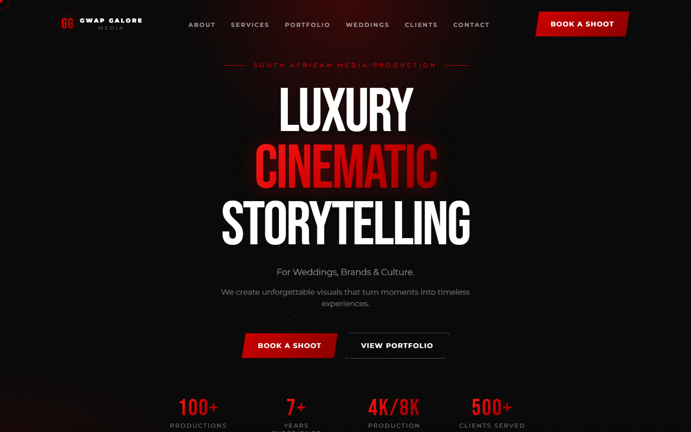

# Gwap Galore Media



Marketing website for **Gwap Galore Media**, a South African media production
studio. A dark, cinematic, scroll-driven site showcasing wedding films, commercial
productions and a full portfolio.

**Live demo:** <https://gwap-galore-mediaa-pi.vercel.app>

## Features

- Cinematic hero with layered imagery and scroll-linked animation.
- Smooth momentum scrolling with Lenis.
- Animated count-up statistics and scroll-reveal sections.
- Sections for services, portfolio, weddings, clients and booking.

## Tech

`Next.js 16` · `React` · `TypeScript` · `Tailwind CSS` · `GSAP` · `Framer Motion` · `Lenis`

## Getting started

```bash
npm install
npm run dev
```
